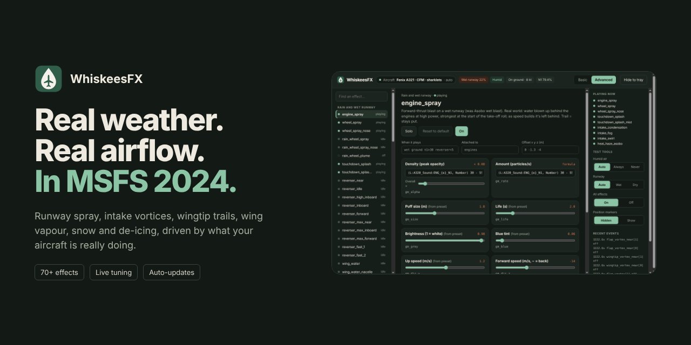
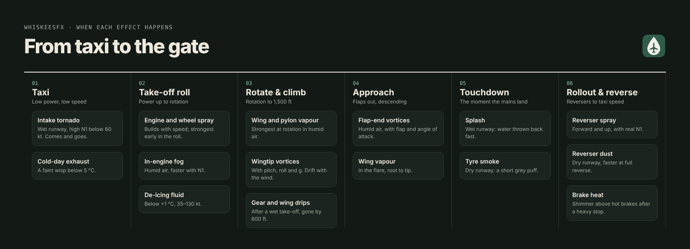
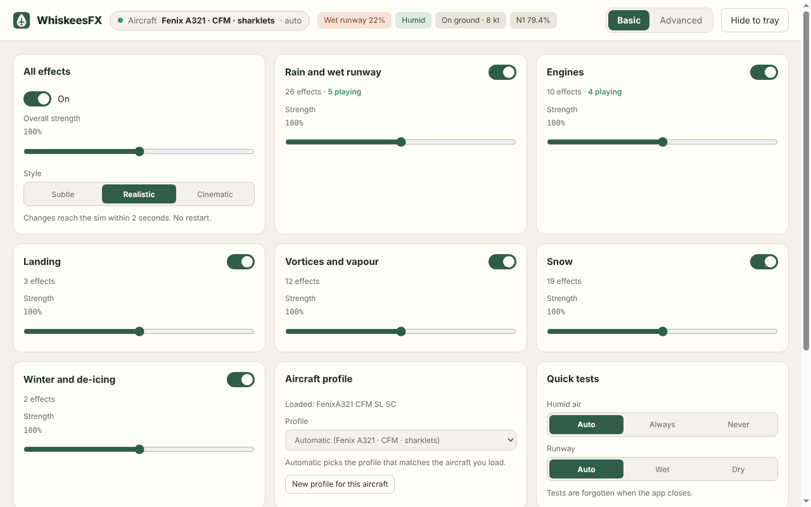
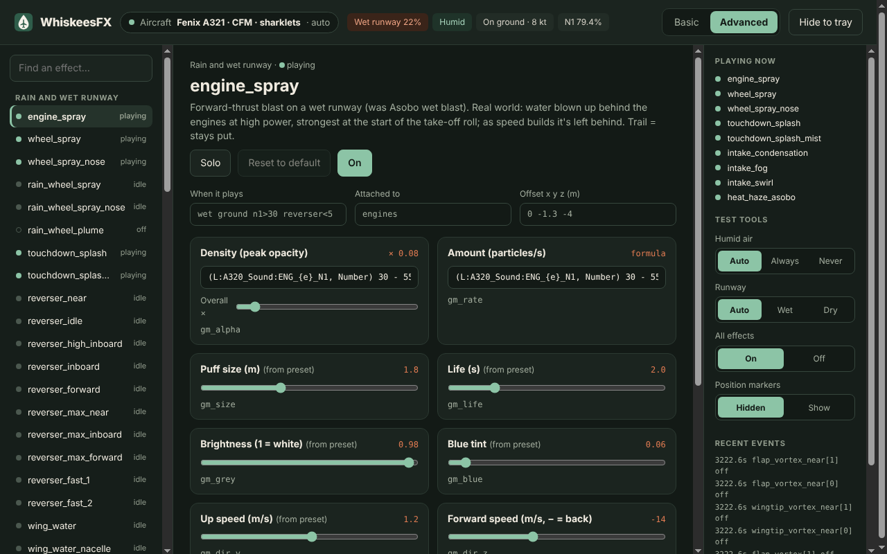

# WhiskeesFX

Real-world weather and airflow effects for **Microsoft Flight Simulator 2024**, driven by what your aircraft is
actually doing. It includes runway spray, intake vortices, wingtip trails, wing vapour, snow, de-icing fluid and
brake heat: more than 70 effects, each timed to when you'd see it on a real airliner.

**[Download the latest release](https://github.com/willkinnaird/whiskeesfx/releases/latest)**

## What's in it

**Rain and wet runways**
- Engine and wheel spray that builds with speed.
- A fast splash at touchdown.
- Reverser water thrown forward and up.
- Drips off the gear and wings after a wet take-off.

**Engines**
- Intake condensation and in-engine fog in humid air.
- The ground "tornado" vortex into the intake on a wet runway.
- A start-up puff.
- Steamy exhaust on cold days.
- Heat shimmer.

**Airflow**
- Wingtip vortices: a clean rope at the tip that coils and drifts with the wind.
- Flap-end vortices.
- Vapour over the wing at rotation and in the flare.
- Pylon vapour.

**Snow and winter**
- Powder from the wheels and reversers.
- Snow tornadoes.
- De-icing fluid streaming off the wing.

**Landing**
- Tyre smoke on dry runways.
- Reverser dust.
- Brake heat shimmer after a heavy stop.

Every effect follows live sim data: speed, real N1, reversers, runway water, humidity, temperature, height, g and
control inputs.

## The app

WhiskeesFX comes with a small tray app.

- **Basic view:** switch each group on or off, set its strength, or pick a style: Subtle, Realistic or Cinematic.
- **Advanced view:** every dial of every effect, changed live while you fly, with no restarts.
- **Aircraft profiles:** picked automatically from the aircraft you load. Profiles are included for the Fenix A319,
  A320 and A321 (CFM or IAE, wingtip fences or sharklets), the PMDG 737-800, 777-300ER and 777F, the iFly 737 MAX 8,
  the iniBuilds A350-900 and A350-1000, and the FlyByWire A380. Any other aircraft gets a generic profile. Use the
  position markers and "New profile for this aircraft" to make your own.
- **Automatic updates:** new versions arrive from this page by themselves. Your own tweaks are kept.
- **Light and dark:** follows your Windows setting.
- **Light on resources:** about 15 MB of memory and no graphics memory. Hiding the window to the tray closes it
  completely.

  
  

## Install

1. Download **WhiskeesFX.exe** from the [latest release](https://github.com/willkinnaird/whiskeesfx/releases/latest)
   and put it somewhere permanent, such as `Documents\WhiskeesFX`.
2. Run it. Windows may say "Windows protected your PC" because the app isn't code-signed yet: choose **More info**,
   then **Run anyway**.
3. The welcome screen finds your sim and Community folder. Press **Install them now** to add the two WhiskeesFX
   packages, tick **Start with Windows**, then press **Get started**.
4. Start a flight. The effects play by themselves; open the app from the tray icon to tune them.

To uninstall, quit the app from the tray, then delete `whiskeesfx-visualfx` and `whiskeesfx-visualfx-effects`
from your Community folder, and the `%APPDATA%\WhiskeesFX` folder.

## Notes

- **Profiles:** positions for aircraft other than the Fenix A321 are educated guesses from published dimensions.
  If an effect sits in the wrong place, show the markers in the Advanced view, nudge the position, and save your
  own profile.
- **Fenix:** Fenix aircraft use their real N1 for the engine effects. Every other aircraft uses the sim's standard
  N1.
- **Status:** this is a work in progress, tuned live against the Fenix A321 and real-world footage.

## For developers

| Folder | What's in it |
|---|---|
| `VisualFX/` | WASM module source, `visualfx.ini` (every effect and its dials), effect builder, research notes |
| `App/` | Tray app (Go, no dependencies), aircraft profiles, release notes in [App/README.md](App/README.md) |
| `packages/` | Built Community packages shipped in each release |
| `CameraFX/` | Camera shake companion |

A release is built by GitHub Actions: push a `v*` tag, or run **Actions → release → Run workflow**.
